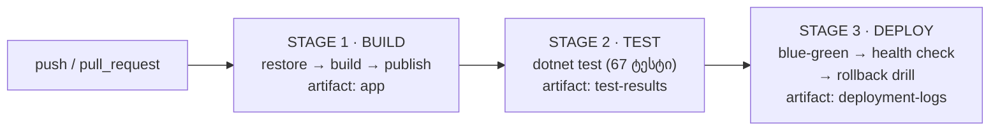
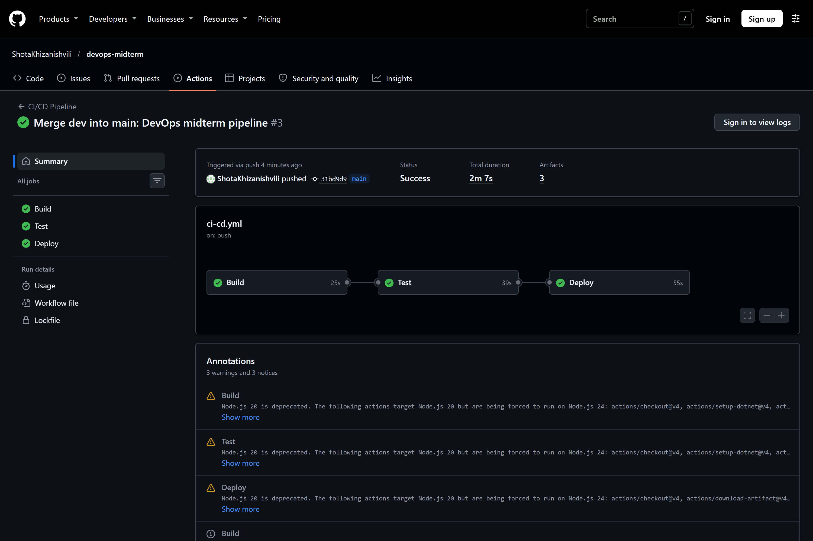
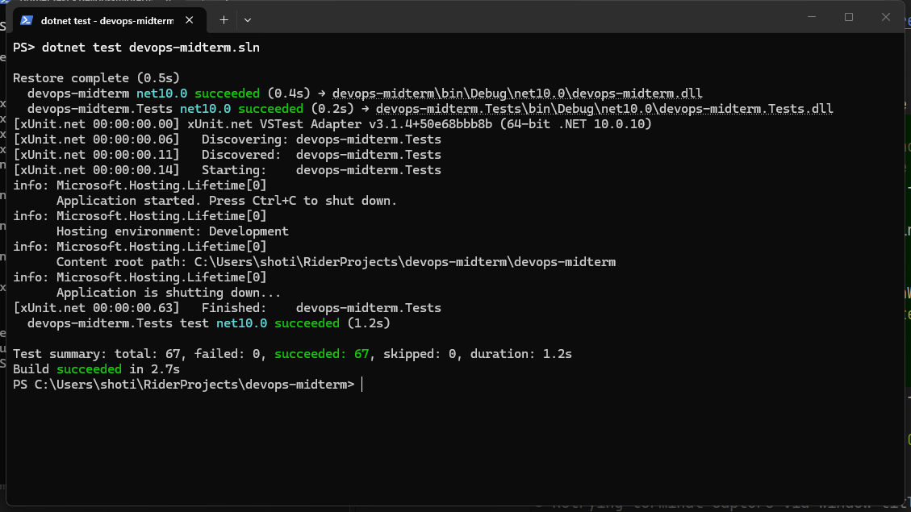
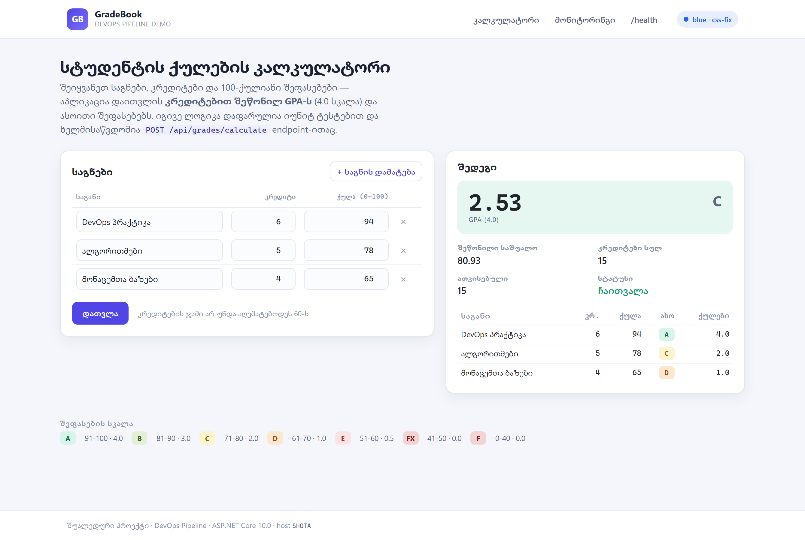
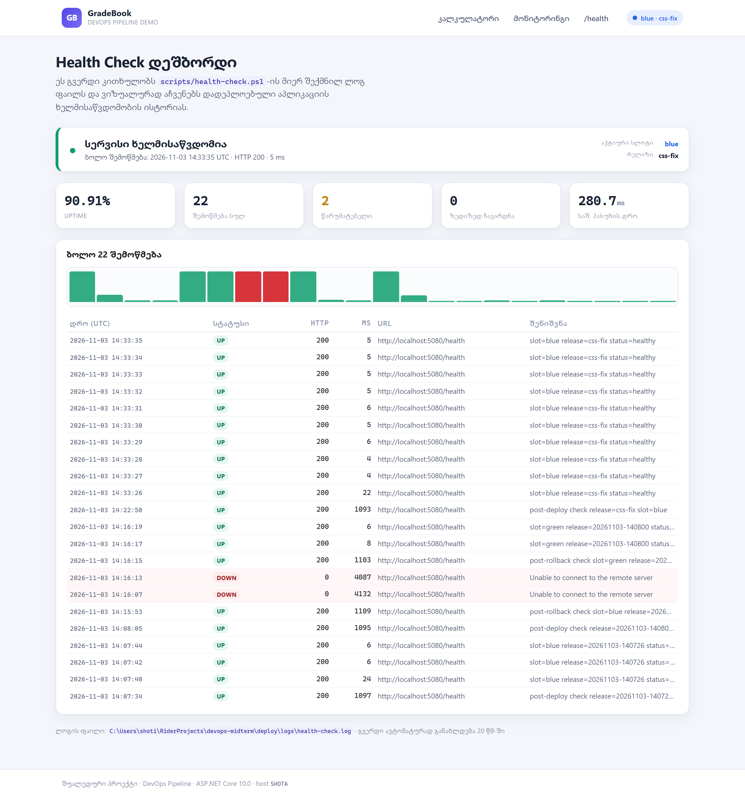
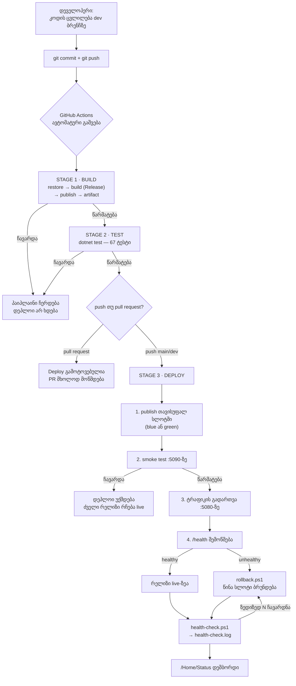

# GradeBook — DevOps Pipeline (შუალედური პროექტი)

[](../../actions/workflows/ci-cd.yml)

სრული DevOps ჯაჭვი ერთ რეპოზიტორიაში: **ვერსიების კონტროლი → ავტომატური ბილდი → ტესტირება →
Blue-Green დეპლოიმენტი → Health Check მონიტორინგი → ავტომატური Rollback**.

---

## სარჩევი

1. [პროექტის აღწერა](#1-პროექტის-აღწერა)
2. [რეპოზიტორიის სტრუქტურა](#2-რეპოზიტორიის-სტრუქტურა)
3. [ვერსიების კონტროლი (Git)](#3-ვერსიების-კონტროლი-git)
4. [CI/CD პროცესი — 3 საფეხური](#4-cicd-პროცესი--3-საფეხური)
5. [დეპლოიმენტის გარემო — Blue-Green](#5-დეპლოიმენტის-გარემო--blue-green)
6. [მონიტორინგი და Health Check](#6-მონიტორინგი-და-health-check)
7. [სქრინშოტები](#7-სქრინშოტები)
8. [სამუშაო პროცესის დიაგრამა](#8-სამუშაო-პროცესის-დიაგრამა)
9. [ლოკალური გაშვება](#9-ლოკალური-გაშვება)
10. [ტესტები](#10-ტესტები)
11. [API](#11-api)

---

## 1. პროექტის აღწერა

**GradeBook** არის ASP.NET Core MVC ვებ-აპლიკაცია — **სტუდენტის ქულების კალკულატორი**.
მომხმარებელი შეჰყავს საგნები, მათი კრედიტები და 100-ქულიანი შეფასებები, აპლიკაცია კი
ითვლის **კრედიტებით შეწონილ GPA-ს** 4.0 სკალაზე და ასოით შეფასებებს.

### რას აკეთებს აპლიკაცია

| მისამართი | დანიშნულება |
|---|---|
| `GET /` | ქულების შეყვანის ფორმა და დათვლის შედეგი |
| `GET /Home/Status` | **მონიტორინგის დეშბორდი** — health check-ების ვიზუალიზაცია (ბონუსი) |
| `GET /health` | ჯანმრთელობის შემოწმების endpoint (JSON, 200 / 503) |
| `POST /api/grades/calculate` | იგივე კალკულაცია JSON API-ის სახით |
| `GET /api/monitoring/history` | health check-ების ისტორია JSON-ად |

### ძირითადი ლოგიკა, რომელიც იტესტება

`GradeCalculator` ასახავს 0–100 ქულას საქართველოს უმაღლესი განათლების სკალაზე და
ითვლის კრედიტებით შეწონილ GPA-ს. ეს არის **სუფთა (pure) ლოგიკა** — არ აქვს არანაირი I/O
ან დამოკიდებულება, რის გამოც CI-ის ტესტის საფეხურს შეუძლია მისი იზოლირებულად შემოწმება.

| ქულა | ასო | GPA ქულები |
|---:|:---:|---:|
| 91–100 | A | 4.0 |
| 81–90 | B | 3.0 |
| 71–80 | C | 2.0 |
| 61–70 | D | 1.0 |
| 51–60 | E | 0.5 |
| 41–50 | FX | 0.0 |
| 0–40 | F | 0.0 |

GPA ითვლება კრედიტებით შეწონილად, ანუ მძიმე საგანი უფრო მეტად მოქმედებს შედეგზე:

```
GPA = Σ(GradePoints × Credits) / Σ(Credits)
```

მაგალითად 10 კრედიტიანი A (4.0) და 2 კრედიტიანი D (1.0) იძლევა
`(4.0×10 + 1.0×2) / 12 = 3.5`-ს და არა 2.5-ს (უბრალო საშუალო).

### გამოყენებული ინსტრუმენტები

| კატეგორია | ინსტრუმენტი |
|---|---|
| ენა / პლატფორმა | C# 13, .NET 10 (ASP.NET Core MVC) |
| ტესტირება | xUnit, `Microsoft.AspNetCore.Mvc.Testing` (integration tests) |
| ვერსიების კონტროლი | Git + GitHub (`main` / `dev` ბრენჩები) |
| CI/CD | GitHub Actions (3 job: Build → Test → Deploy) |
| დეპლოიმენტი | PowerShell სკრიპტები, Blue-Green სლოტები + Rollback |
| მონიტორინგი | PowerShell health check → `.log` ფაილი → ვიზუალური დეშბორდი |
| Frontend | Razor Views, Bootstrap 5 (ლოკალურად), custom CSS |

---

## 2. რეპოზიტორიის სტრუქტურა

```
devops-midterm/
├── .github/workflows/
│   └── ci-cd.yml                  # 3-საფეხურიანი პაიპლაინი (Build → Test → Deploy)
├── devops-midterm/                # ASP.NET Core ვებ-აპლიკაცია
│   ├── Controllers/HomeController.cs
│   ├── Models/                    # ფორმის და API-ის მოდელები
│   ├── Services/
│   │   ├── GradeCalculator.cs     # ← ძირითადი ლოგიკა (იუნიტ ტესტების ობიექტი)
│   │   ├── HealthLogParser.cs     # ← health ლოგის პარსერი (ასევე იტესტება)
│   │   ├── MonitoringService.cs   # ლოგ ფაილის კითხვა დეშბორდისთვის
│   │   └── DeploymentInfo.cs      # აქტიური slot / release
│   ├── Views/Home/Index.cshtml    # კალკულატორი
│   ├── Views/Home/Status.cshtml   # მონიტორინგის დეშბორდი (ბონუსი)
│   └── Program.cs                 # /health და JSON API endpoint-ები
├── devops-midterm.Tests/          # xUnit ტესტები (67 ტესტი)
│   ├── GradeCalculatorTests.cs
│   ├── HealthLogParserTests.cs
│   └── WebEndpointTests.cs        # integration ტესტები რეალურ pipeline-ზე
├── scripts/
│   ├── common.ps1                 # საერთო ფუნქციები
│   ├── deploy.ps1                 # Blue-Green დეპლოიმენტი
│   ├── rollback.ps1               # წინა რელიზზე დაბრუნება
│   ├── health-check.ps1           # მონიტორინგი + ავტომატური rollback
│   └── stop.ps1                   # გაშვებული აპლიკაციის გაჩერება
├── docs/
│   ├── screenshots/               # README-ში ჩაშენებული სქრინშოტები
│   ├── workflow-diagram.md        # დამატებითი დიაგრამები
│   └── sample-health-check.log    # რეალური ლოგის ნიმუში
└── README.md
```

---

## 3. ვერსიების კონტროლი (Git)

პროექტი იყენებს **ორ ბრენჩს**:

| ბრენჩი | დანიშნულება |
|---|---|
| `main` | სტაბილური, დასარელიზებელი კოდი. აქ მოხვედრა მხოლოდ Pull Request-ით. |
| `dev` | აქტიური განვითარება — ყველა ახალი ფუნქციონალი ჯერ აქ იწერება. |

**სამუშაო პროცესი:**

```
dev-ზე მუშაობა → commit-ები → push → CI (Build+Test+Deploy)
                                   ↓
                     Pull Request: dev → main → CI (Build+Test)
                                   ↓
                              merge main-ში → CI (Build+Test+Deploy)
```

commit-ები დაყოფილია ლოგიკური ნაბიჯების მიხედვით და იყენებს conventional commit-ის
სტილს (`feat:`, `ci:`, `docs:`, `fix:`, `chore:`), რათა ისტორიიდან ნათლად ჩანდეს
პროექტის აწყობის თანმიმდევრობა.

---

## 4. CI/CD პროცესი — 3 საფეხური

ფაილი: [`.github/workflows/ci-cd.yml`](.github/workflows/ci-cd.yml)

პაიპლაინი **ავტომატურად იშვება**:

* ყოველ `push`-ზე `main` ან `dev` ბრენჩში
* ყოველ `Pull Request`-ზე ამ ბრენჩებისკენ
* ხელით, `workflow_dispatch`-ით



### საფეხური 1 — Build (ბილდი)

| ნაბიჯი | ბრძანება |
|---|---|
| გარემოს მომზადება | `actions/setup-dotnet@v4` (.NET 10) |
| დამოკიდებულებების დაყენება | `dotnet restore devops-midterm.sln` |
| კომპილაცია | `dotnet build -c Release --no-restore` |
| გამოქვეყნება | `dotnet publish -c Release --no-build -o publish` |
| არტეფაქტი | `actions/upload-artifact@v4` → `app` |

პროექტში ჩართულია `TreatWarningsAsErrors`, ამიტომ **ნებისმიერი warning წყვეტს ბილდს** —
ეს ეტაპი რეალური ფილტრია და არა ფორმალობა.

### საფეხური 2 — Test (ტესტირება)

| ნაბიჯი | ბრძანება |
|---|---|
| ტესტების გაშვება | `dotnet test -c Release --logger "trx;..."` |
| შედეგების შენახვა | `actions/upload-artifact@v4` → `test-results` |
| რეზიუმე | `.trx` ფაილიდან იკითხება total/passed/failed და იწერება GitHub-ის Job Summary-ში |

თუ ერთი ტესტიც ჩავარდა, job წითლდება და **Deploy საფეხური საერთოდ არ იშვება**
(`needs: test`).

### საფეხური 3 — Deploy (დეფლოი)

ამ ეტაპზე პაიპლაინი იღებს Build-ის არტეფაქტს და უშვებს **რეალურ დეპლოიმენტის
სკრიპტებს** — იმავეს, რასაც ლოკალურად ვუშვებთ:

| ნაბიჯი | რა ხდება |
|---|---|
| 1. `deploy.ps1` (რელიზი .1) | არტეფაქტი თავსდება თავისუფალ სლოტში, smoke test, ტრაფიკის გადართვა |
| 2. `health-check.ps1` | 5 შემოწმება `/health`-ზე, შედეგი ლოგში |
| 3. `deploy.ps1` (რელიზი .2) | მეორე დეპლოი — სლოტების გადართვა (blue ↔ green) |
| 4. `health-check.ps1` | 3 შემოწმება გადართვის შემდეგ |
| 5. `rollback.ps1` | **Rollback-ის სავარჯიშო** — წინა რელიზზე დაბრუნება |
| 6. `health-check.ps1` | 3 შემოწმება rollback-ის შემდეგ |
| 7. Job Summary | state.json + მთლიანი health-check.log იწერება GitHub-ის summary-ში |
| 8. `stop.ps1` + არტეფაქტი | აპლიკაცია ჩერდება, ლოგები იტვირთება `deployment-logs`-ად |

> **რატომ არ იშვება Deploy pull request-ზე?**
> `if: github.event_name != 'pull_request'` — PR არის შესამოწმებელი და არა გასაშვები.
> PR-ის დროს მუშაობს Build + Test, ხოლო merge-ის შემდეგ, `main`-ზე push-ის დროს —
> სამივე საფეხური.

---

## 5. დეპლოიმენტის გარემო — Blue-Green

არჩეულია **გზა ა (ლოკალური დეპლოიმენტი)**: აპლიკაცია იდება ლოკალურ production
საქაღალდეში `deploy/`, ორი სლოტით და rollback მექანიზმით.

```
deploy/
├── blue/                   ← რელიზი N      (ერთ-ერთი ემსახურება :5080-ს)
├── green/                  ← რელიზი N-1    (მეორე ელოდება rollback-ს)
├── state.json              ← რომელი სლოტია live, რომელზე დავბრუნდეთ
└── logs/
    ├── deploy.log          ← დეპლოიმენტის აუდიტი
    ├── health-check.log    ← მონიტორინგის ლოგი
    └── app.out.log / app.err.log
```

### როგორ მუშაობს გადართვა

1. **publish თავისუფალ სლოტში** — live სლოტს არავინ ეხება.
2. **smoke test დროებით პორტზე (:5090)** — ახალი ბილდი მოწმდება *სანამ* ტრაფიკს მიიღებს.
   თუ აქ ჩავარდა, დეპლოი წყდება და ძველი რელიზი უბრალოდ აგრძელებს მუშაობას.
3. **ტრაფიკის გადართვა** — ძველი პროცესი ჩერდება, ახალი სლოტი იშვება იმავე `:5080` პორტზე.
4. **`/health`-ის შემოწმება** — თუ ახალი რელიზი ავად არის, ავტომატურად იძახება `rollback.ps1`.

რადგან ძველი რელიზი დისკზე რჩება მეორე სლოტში, **rollback არის პროცესის გადატვირთვა
და არა თავიდან აწყობა** — რამდენიმე წამი.

### რა ხდება, როცა დეპლოი ჩავარდება

| სცენარი | შედეგი |
|---|---|
| არტეფაქტი არასწორია | დეპლოი ჩერდება *სანამ* რამეს წაშლის — არაფერი იცვლება |
| ბილდი/publish ჩავარდა | live რელიზი უცვლელად აგრძელებს მუშაობას |
| smoke test ჩავარდა (:5090) | **ტრაფიკი საერთოდ არ გადაირთო** — live რელიზი არც კი გადატვირთულა |
| `/health` ჩავარდა გადართვის შემდეგ | ავტომატურად იძახება `rollback.ps1` და ბრუნდება წინა რელიზი |
| ზედიზედ N ჩავარდნა მონიტორინგში | `health-check.ps1 -AutoRollback` თავად აბრუნებს წინა რელიზს |

> ახალი რელიზის განთავსება **გადააწერს** თავისუფალ სლოტს, რომელიც rollback-ის
> სამიზნეც არის. ამიტომ, თუ დეპლოი შეწყდა განთავსების შემდეგ, `state.json`-ში
> rollback-ის სამიზნე იწმინდება — წინააღმდეგ შემთხვევაში `rollback.ps1` გაუშვებდა
> სწორედ იმ გატეხილ ბილდს, რომელმაც ჩააგდო დეპლოი.

### ბრძანებები

```powershell
# დეპლოი (ბილდავს წყაროდან და დებს თავისუფალ სლოტში)
powershell -ExecutionPolicy Bypass -File .\scripts\deploy.ps1

# დაბრუნება წინა რელიზზე
powershell -ExecutionPolicy Bypass -File .\scripts\rollback.ps1

# გაჩერება
powershell -ExecutionPolicy Bypass -File .\scripts\stop.ps1
```

`deploy.ps1`-ის მთავარი პარამეტრები:

| პარამეტრი | ნაგულისხმევი | აღწერა |
|---|---|---|
| `-ArtifactPath` | *(ცარიელი)* | უკვე აწყობილი აპლიკაციის საქაღალდე (CI იყენებს) |
| `-DeployRoot` | `deploy` | production საქაღალდე |
| `-Port` | `5080` | მუდმივი production პორტი |
| `-SmokePort` | `5090` | დროებითი პორტი შემოწმებისთვის |
| `-Release` | დროის შტამპი | რელიზის იდენტიფიკატორი |
| `-NoRollback` | — | გამორთავს ავტომატურ rollback-ს (დემოსთვის) |

---

## 6. მონიტორინგი და Health Check

### `/health` endpoint

არ არის „მხოლოდ პროცესი ცოცხალია" ტიპის შემოწმება — endpoint **თავიდან უშვებს ძირითად
ბიზნეს-ლოგიკას** და მხოლოდ მაშინ აბრუნებს `200`-ს, თუ შედეგი სწორია. თუ ლოგიკა გატყდა,
პასუხია `503` და მონიტორინგი ამას დაინახავს.

```json
{
  "status": "healthy",
  "slot": "blue",
  "release": "css-fix",
  "version": "1.0.0.0",
  "host": "SHOTA",
  "uptimeSeconds": 18.4,
  "timestamp": "2026-11-03T14:07:52Z"
}
```

`slot` და `release` ველები სწორედ იმიტომ არსებობს, რომ **rollback ვიზუალურად დადასტურდეს** —
დაბრუნების შემდეგ `/health` აჩვენებს სხვა სლოტს და წინა რელიზს.

### `health-check.ps1`

```powershell
# ერთი შემოწმება
powershell -ExecutionPolicy Bypass -File .\scripts\health-check.ps1

# 12 შემოწმება 5 წამის ინტერვალით, ავტომატური rollback-ით
powershell -ExecutionPolicy Bypass -File .\scripts\health-check.ps1 `
    -Attempts 12 -IntervalSeconds 5 -AutoRollback
```

თითოეული შემოწმება წერს **ერთ ხაზს** `deploy/logs/health-check.log` ფაილში:

```
2026-11-03T14:07:40Z | UP   | 200 | 24ms   | http://localhost:5080/health | slot=blue release=20261103-140726 status=healthy
2026-11-03T14:16:07Z | DOWN | 0   | 4132ms | http://localhost:5080/health | Unable to connect to the remote server
```

| ველი | მნიშვნელობა |
|---|---|
| 1 | დრო (UTC, ISO-8601) |
| 2 | სტატუსი — `UP` / `DOWN` |
| 3 | HTTP კოდი (`0` = საერთოდ ვერ დაუკავშირდა) |
| 4 | პასუხის დრო |
| 5 | შემოწმებული URL |
| 6 | შენიშვნა — slot/release ან შეცდომის ტექსტი |

ფორმატი განზრახ არის მანქანურად წასაკითხი: იმავე ხაზებს კითხულობს `HealthLogParser`
და მათგან აწყობს დეშბორდს. ნიმუში: [`docs/sample-health-check.log`](docs/sample-health-check.log).

### ბონუსი 1 — ვიზუალური დეშბორდი

`/Home/Status` კითხულობს ამ ლოგს და აჩვენებს: მიმდინარე სტატუსს, uptime-ს პროცენტებში,
შემოწმებების რაოდენობას, ზედიზედ ჩავარდნების რაოდენობას, საშუალო პასუხის დროს,
პასუხის დროების გრაფიკს და ბოლო შემოწმებების ცხრილს. გვერდი თავად განახლდება 20 წამში.

### ბონუსი 2 — ავტომატური Rollback

`health-check.ps1 -AutoRollback` ითვლის **ზედიზედ** ჩავარდნებს და როცა მათი რაოდენობა
მიაღწევს `-FailureThreshold`-ს (ნაგულისხმევად 3), თავად იძახებს `rollback.ps1`-ს.

რეალური გაშვების ლოგი (წინასწარ „გატეხილი" რელიზი — live პროცესი ხელით მოვკალით):

```
  [1/4] 2026-11-03T14:16:07Z | DOWN | 0 | 4132ms | http://localhost:5080/health | Unable to connect to the remote server
  [2/4] 2026-11-03T14:16:13Z | DOWN | 0 | 4087ms | http://localhost:5080/health | Unable to connect to the remote server
  2 consecutive failures -> rolling back
2026-11-03T14:16:13Z | WARN  | === rollback start | reason: 2 consecutive failed health checks ===
2026-11-03T14:16:13Z | INFO  | rolling back 'blue' (20261103-140726) -> 'green' (20261103-140800)
2026-11-03T14:16:15Z | OK    | rollback complete - slot 'green' is live on http://localhost:5080 in 1103ms
  [3/4] 2026-11-03T14:16:17Z | UP | 200 | 8ms | http://localhost:5080/health | slot=green release=20261103-140800 status=healthy
  [4/4] 2026-11-03T14:16:19Z | UP | 200 | 6ms | http://localhost:5080/health | slot=green release=20261103-140800 status=healthy

  checks: 4   up: 2   down: 2   uptime: 50%
```

---

## 7. სქრინშოტები

### 7.1 წარმატებით გავლილი 3-საფეხურიანი პაიპლაინი



GitHub Actions-ის გაშვება `main` ბრენჩზე: სამივე job — **Build → Test → Deploy** —
მწვანეა და დალაგებულია თანმიმდევრობით (`needs`-ით). მარცხენა პანელზე ჩანს სამივე
საფეხური, ქვემოთ კი — ატვირთული არტეფაქტები (`app`, `test-results`, `deployment-logs`).

### 7.2 წარმატებული იუნიტ ტესტები



Test საფეხურის ლოგი: `dotnet test` ასრულებს **67 ტესტს** — 0 ჩავარდნილი.
იტესტება როგორც სუფთა ლოგიკა (GPA-ის დათვლა, ვალიდაცია, ლოგის პარსინგი), ისე
რეალური HTTP endpoint-ები in-memory სერვერზე.

### 7.3 მომუშავე აპლიკაცია



დადეპლოებული აპლიკაცია `http://localhost:5080`-ზე. ზედა მარჯვენა კუთხეში ჩანს
**აქტიური blue-green სლოტი და რელიზი** — ინფორმაცია, რომელიც პირდაპირ `/health`
endpoint-იდან მოდის.

### 7.4 ბონუსი — მონიტორინგის დეშბორდი



`/Home/Status` — health check-ების ლოგიდან აწყობილი დეშბორდი: uptime, შემოწმებების
რაოდენობა, ჩავარდნები, საშუალო პასუხის დრო, პასუხის დროების გრაფიკი (წითელი = DOWN)
და ბოლო შემოწმებების ცხრილი.

---

## 8. სამუშაო პროცესის დიაგრამა



დამატებითი დიაგრამები (blue-green sequence diagram და health check-ის state machine):
[`docs/workflow-diagram.md`](docs/workflow-diagram.md).

---

## 9. ლოკალური გაშვება

### წინაპირობები

* [.NET SDK 10](https://dotnet.microsoft.com/download)
* Windows PowerShell 5.1 (Windows-ზე უკვე არის) ან PowerShell 7+ (`pwsh`)

### დეველოპმენტის რეჟიმი

```powershell
dotnet run --project devops-midterm/devops-midterm.csproj
# → http://localhost:5267
```

### ტესტების გაშვება

```powershell
dotnet test devops-midterm.sln
```

### სრული დეპლოიმენტი და მონიტორინგი

```powershell
# 1. ბილდი + Blue-Green დეპლოი ლოკალურ production საქაღალდეში
powershell -ExecutionPolicy Bypass -File .\scripts\deploy.ps1

# 2. მონიტორინგი — 10 შემოწმება, ავტომატური rollback-ით
powershell -ExecutionPolicy Bypass -File .\scripts\health-check.ps1 -Attempts 10 -IntervalSeconds 3 -AutoRollback

# 3. დეშბორდი
start http://localhost:5080/Home/Status

# 4. გაჩერება
powershell -ExecutionPolicy Bypass -File .\scripts\stop.ps1
```

---

## 10. ტესტები

სულ **67 ტესტი** სამ ფაილში:

| ფაილი | რას ფარავს |
|---|---|
| `GradeCalculatorTests.cs` | შეფასების სკალის ყველა ზღვარი (A/B/C/D/E/FX/F), კრედიტებით შეწონვა, დამრგვალება, ჩაჭრილი საგნები, ყველა ვალიდაციის წესი (ცარიელი სია, ცარიელი სახელი, კრედიტი დიაპაზონს გარეთ, ქულა 0–100-ს გარეთ, `NaN`, 60 კრედიტზე მეტი დატვირთვა) |
| `HealthLogParserTests.cs` | ლოგის ხაზის პარსინგი, გაფუჭებული/ცარიელი ხაზების იგნორირება, uptime-ის დათვლა, ზედიზედ ჩავარდნების სწორი თვლა, ქრონოლოგიური დალაგება, საშუალო latency |
| `WebEndpointTests.cs` | **integration** — რეალური ASP.NET Core pipeline in-memory: `/health`, `/`, `/Home/Status`, `/api/grades/calculate` (სწორი და არასწორი მონაცემებით), `/api/monitoring/history` |

მაგალითი — ტესტი, რომელიც იცავს ყველაზე მნიშვნელოვან ქცევას:

```csharp
[Fact]
public void Calculate_weights_the_gpa_by_credits_not_by_course_count()
{
    // 10 credits of A (4.0) and 2 credits of D (1.0):
    // (4.0*10 + 1.0*2) / 12 = 3.5 -- a plain average would have given 2.5.
    var result = GradeCalculator.Calculate([
        new CourseEntry("Heavy course", 10, 95),
        new CourseEntry("Light course", 2, 65)
    ]);

    Assert.Equal(3.5, result.Gpa);
    Assert.NotEqual(2.5, result.Gpa);
}
```

---

## 11. API

### `POST /api/grades/calculate`

```bash
curl -X POST http://localhost:5080/api/grades/calculate \
  -H "Content-Type: application/json" \
  -d '{"courses":[{"name":"DevOps","credits":10,"score":95},
                  {"name":"Light","credits":2,"score":65}]}'
```

```json
{
  "gpa": 3.5,
  "averageScore": 90,
  "letter": "B",
  "totalCredits": 12,
  "earnedCredits": 12,
  "passed": true,
  "courses": [
    { "name": "DevOps", "credits": 10, "score": 95, "letter": "A", "gradePoints": 4, "passed": true },
    { "name": "Light",  "credits": 2,  "score": 65, "letter": "D", "gradePoints": 1, "passed": true }
  ]
}
```

არასწორი მონაცემებისთვის (ქულა 0–100-ს გარეთ, ცარიელი სია და ა.შ.) ბრუნდება `400`
და შეცდომის აღწერა.

### `GET /health`

ბრუნებს `200`-ს, როცა აპლიკაცია ჯანმრთელია, და `503`-ს, როცა ძირითადი ლოგიკა გატყდა.
სწორედ ამას ეყრდნობა მთელი მონიტორინგისა და rollback-ის მექანიზმი.
