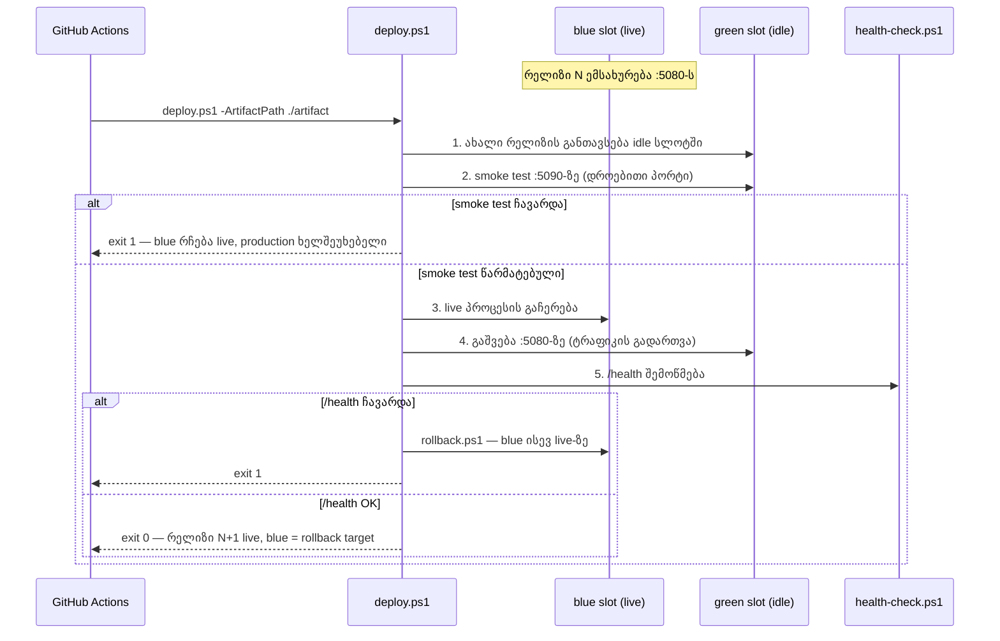
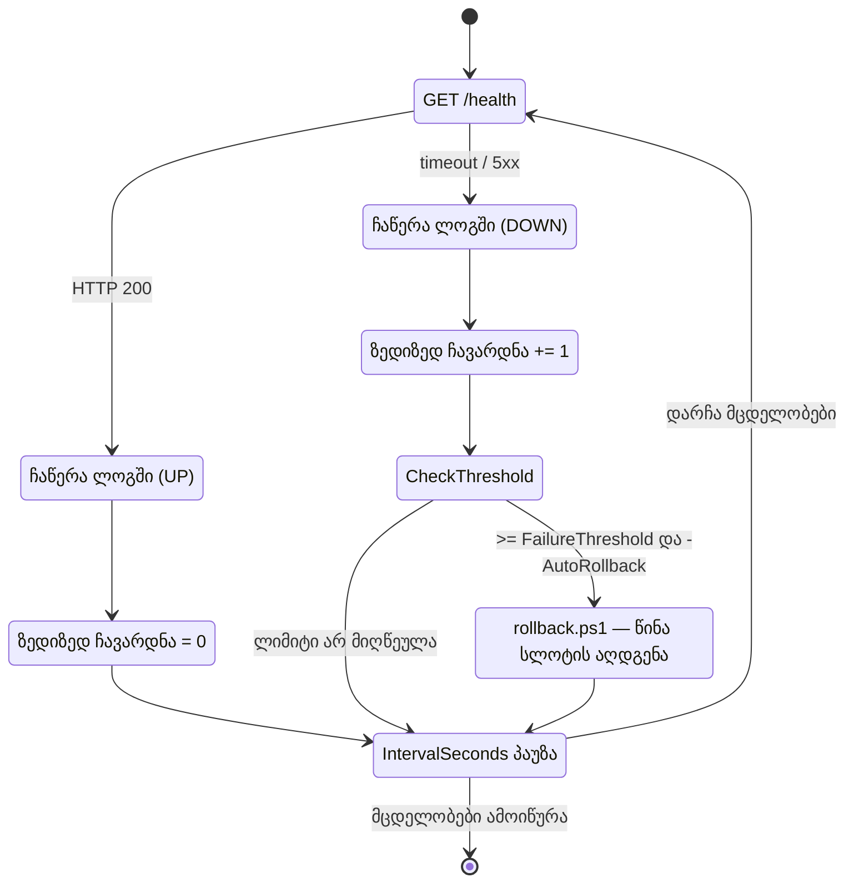

# სამუშაო პროცესის დიაგრამა (Workflow Diagram)

ქვემოთ მოცემული დიაგრამები რენდერდება GitHub-ზე ავტომატურად (Mermaid).

## 1. მთლიანი DevOps ციკლი — კოდიდან მონიტორინგამდე

```mermaid
flowchart LR
    subgraph DEV["დეველოპერი"]
        A["კოდის შეცვლა<br/>dev ბრენჩზე"]
        B["git commit<br/>+ git push"]
    end

    subgraph GIT["GitHub (ვერსიების კონტროლი)"]
        C["dev branch"]
        D["Pull Request<br/>dev -> main"]
        E["main branch"]
    end

    subgraph CI["GitHub Actions - CI/CD Pipeline"]
        F["STAGE 1<br/>BUILD<br/>restore + build + publish"]
        G["STAGE 2<br/>TEST<br/>67 xunit ტესტი"]
        H["STAGE 3<br/>DEPLOY<br/>blue-green + health check"]
    end

    subgraph PROD["Production (ლოკალური გარემო)"]
        I["blue slot"]
        J["green slot"]
        K["http://localhost:5080"]
    end

    subgraph MON["მონიტორინგი"]
        L["health-check.ps1"]
        M["health-check.log"]
        N["/Home/Status<br/>დეშბორდი"]
    end

    A --> B --> C
    C -->|push| F
    C --> D
    D -->|PR: build + test only| F
    D -->|merge| E
    E -->|push| F
    F -->|artifact| G
    G -->|tests pass| H
    H --> I
    H --> J
    I --> K
    J --> K
    K --> L --> M --> N
    L -. "DOWN x3" .-> O["rollback.ps1"]
    O -. "აღადგენს წინა რელიზს" .-> K
```

## 2. Blue-Green დეპლოიმენტი და Rollback

## 3. Health Check-ის ლოგიკა (ავტომატური Rollback)

